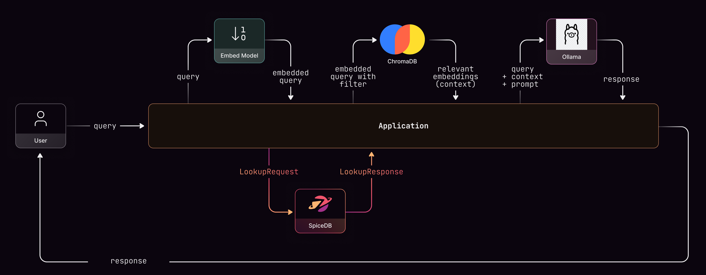

# Build Fine-Grained RAG Permissions with SpiceDB and Chroma, Part 2: Implementation

!!! note "Source Code"

    The full, runnable source code for this two-part guide can be found
    [here](https://github.com/authzed/examples/tree/main/chroma-spicedb-rag).

[Part 1](authorization-model-with-spicedb.md) built the model: a SpiceDB schema
where a user can `view` a `document`, and a way to ask "can this user see this
document?" Now we'll make the retriever ask that question before presenting information to the user.

Each vector in Chroma carries a `doc_id` in its
metadata that points back to a `document:<id>` in SpiceDB. At query time we make
sure the documents that reach the model are only the ones the asking user is
allowed to `view`. There are two ways to do that, and we'll build both.

## Prerequisites

- SpiceDB and Chroma running locally. The
  [companion repo](https://github.com/authzed/examples/tree/main/chroma-spicedb-rag)'s
  `docker compose up -d` starts both, or run SpiceDB as shown in
  [Part 1](authorization-model-with-spicedb.md).
- Python 3.10+.
- [Ollama](https://ollama.com/) with a small model pulled, for the final
  end-to-end step: `ollama pull llama3.2`.

## Setup

```bash
pip install chromadb authzed ollama
```

We'll keep the clients and a couple of helpers in one place. Note the SpiceDB
client is `SyncClient`, the synchronous flavor, talking to a local, insecure
gRPC endpoint:

```python
# common.py
import os

import chromadb
from authzed.api.v1 import SyncClient, ObjectReference, SubjectReference, Consistency
from grpcutil import insecure_bearer_token_credentials

SPICEDB_ENDPOINT = os.environ.get("SPICEDB_ENDPOINT", "localhost:50051")
SPICEDB_TOKEN = os.environ.get("SPICEDB_TOKEN", "somerandomkeyhere")
CHROMA_HOST = os.environ.get("CHROMA_HOST", "localhost")
CHROMA_PORT = int(os.environ.get("CHROMA_PORT", "8000"))

COLLECTION_NAME = "rag_documents"
USER = "kim"

# Read-your-writes: after seeding relationships we want checks to see them
# immediately, so the demo uses full consistency. More on this below.
FULLY_CONSISTENT = Consistency(fully_consistent=True)


def spicedb_client():
    return SyncClient(SPICEDB_ENDPOINT, insecure_bearer_token_credentials(SPICEDB_TOKEN))


def chroma_client():
    return chromadb.HttpClient(host=CHROMA_HOST, port=CHROMA_PORT)


def resource(doc_id):
    return ObjectReference(object_type="document", object_id=doc_id)


def user_subject(uid=USER):
    return SubjectReference(object=ObjectReference(object_type="user", object_id=uid))
```

## Indexing: link every vector to a document

The one rule that makes all of this work: **every record you add to Chroma
carries metadata - i.e the the `doc_id` of the SpiceDB `document` it belongs to.** Here we index a
handful of sample documents using Chroma's default embedding function
(all-MiniLM-L6-v2, downloaded on first use, no API key required):

```python
# index_documents.py
from common import chroma_client, COLLECTION_NAME
from data import DOCUMENTS


def main():
    client = chroma_client()
    try:
        client.delete_collection(COLLECTION_NAME)
    except Exception:
        pass
    collection = client.create_collection(COLLECTION_NAME)

    collection.add(
        ids=[d["id"] for d in DOCUMENTS],
        documents=[d["text"] for d in DOCUMENTS],
        metadatas=[{"doc_id": d["id"]} for d in DOCUMENTS],
    )
    print(f"indexed {collection.count()} documents into '{COLLECTION_NAME}'")


if __name__ == "__main__":
    main()
```

One document is one record here to keep things readable. In a real corpus you'd
chunk each document into many vectors. Just repeat the parent `doc_id` on every
chunk's metadata, and everything below works in the same way. The `doc_id` is basically the
join key between "what the vector database stores" and "what the authorization
system knows."

## Seeding relationships

Kim should see some documents and not others. We write `viewer` relationships
for the ones she's allowed to read (the schema write and the full corpus live in
the companion repo's `bootstrap.py` and `data.py`):

```python
from authzed.api.v1 import WriteRelationshipsRequest, RelationshipUpdate, Relationship
from common import spicedb_client, resource, user_subject, USER
from data import AUTHORIZED_IDS

client = spicedb_client()
updates = [
    RelationshipUpdate(
        operation=RelationshipUpdate.OPERATION_TOUCH,
        relationship=Relationship(
            resource=resource(doc_id),
            relation="viewer",
            subject=user_subject(USER),
        ),
    )
    for doc_id in AUTHORIZED_IDS
]
client.WriteRelationships(WriteRelationshipsRequest(updates=updates))
```

In a real-life system, you would create, update or delete a relationship anytime the state of a system changes.

## Strategy 1: Pre-filter

The pre-filter technique is to ask SpiceDB *first* what the user is allowed to view. `LookupResources` answers this question in one call:
"give me every document this user can `view`." You can then constrain the Chroma query
to exactly that set with a `$in` metadata filter, and the vector search will retrieve only
from the documents Kim is authorized to view.



```python
# query_prefilter.py
from authzed.api.v1 import LookupResourcesRequest
from common import spicedb_client, chroma_client, user_subject, COLLECTION_NAME, USER, FULLY_CONSISTENT

QUESTION = "What confidential salary information do we have?"


def authorized_doc_ids(client, uid=USER):
    resp = client.LookupResources(LookupResourcesRequest(
        resource_object_type="document",
        permission="view",
        subject=user_subject(uid),
        consistency=FULLY_CONSISTENT,
    ))
    return [item.resource_object_id for item in resp]


def main():
    sc = spicedb_client()
    ids = authorized_doc_ids(sc)
    print("authorized doc_ids:", sorted(ids))

    collection = chroma_client().get_collection(COLLECTION_NAME)
    results = collection.query(
        query_texts=[QUESTION],
        where={"doc_id": {"$in": ids}},
        n_results=3,
    )
    print("returned ids:", results["ids"][0])
```

Run it, and note what happens even though the user's question asks for information about the
for the salary document, a document the user cannot access.

```text
authorized doc_ids: ['eng-oncall', 'office-wifi', 'roadmap-q3']
returned ids: ['eng-oncall', 'roadmap-q3', 'office-wifi']
```

## Strategy 2: post-filter

This is the inverse of the pre-filter method where we let Chroma retrieve relevant documents *first*, then check user  permissions for each of the documents returned. SpiceDB has a `CheckBulkPermissions` call that checks every returned
document at once, so it's a single API call to check permissions for multiple resources.


```python
# query_postfilter.py
from authzed.api.v1 import (
    CheckBulkPermissionsRequest,
    CheckBulkPermissionsRequestItem,
    CheckPermissionResponse,
)
from common import spicedb_client, chroma_client, resource, user_subject, COLLECTION_NAME, USER, FULLY_CONSISTENT

QUESTION = "What confidential salary information do we have?"
HAS = CheckPermissionResponse.PERMISSIONSHIP_HAS_PERMISSION


def filter_authorized(sc, doc_ids, uid=USER):
    if not doc_ids:
        return []
    resp = sc.CheckBulkPermissions(CheckBulkPermissionsRequest(
        consistency=FULLY_CONSISTENT,
        items=[
            CheckBulkPermissionsRequestItem(
                resource=resource(doc_id),
                permission="view",
                subject=user_subject(uid),
            )
            for doc_id in doc_ids
        ],
    ))
    return [
        pair.request.resource.object_id
        for pair in resp.pairs
        if pair.item.permissionship == HAS
    ]


def main():
    collection = chroma_client().get_collection(COLLECTION_NAME)
    results = collection.query(query_texts=[QUESTION], n_results=5)
    candidate_ids = [m["doc_id"] for m in results["metadatas"][0]]
    print("candidate ids:", candidate_ids)

    sc = spicedb_client()
    allowed = filter_authorized(sc, candidate_ids)
    print("allowed ids:", allowed)
```

This time the output is the whole point:

```text
candidate ids: ['salary-bands', 'board-notes', 'eng-oncall', 'roadmap-q3', 'office-wifi']
allowed ids: ['eng-oncall', 'roadmap-q3', 'office-wifi']
```

The vector search retrieves the two most relevant documents
to a salary question, namely `salary-bands` and `board-notes`. Then `CheckBulkPermissions` filtered those two out as the user isn't authorized to access it. This way the large language model never sees them.

## Pre-filter or post-filter?

How do you choose between the two? Well, It Depends:

| | Pre-filter (`LookupResources`) | Post-filter (`CheckBulkPermissions`) |
| --- | --- | --- |
| **Order** | SpiceDB → Chroma | Chroma → SpiceDB |
| **Best for** | Large corpus, user sees a small fraction | Smaller corpus, high hit-rate, broad access |
| **Search space** | Shrunk before searching | Full, then trimmed |
| **Weak spot** | Huge authorized sets → unwieldy `$in` list | Wasted retrieval work on docs you'll discard |

A reasonable default: start with pre-filter, and switch to (or combine with)
post-filter if a user's authorized set gets large enough that the `$in` list
becomes a problem. You could also pre-filter with a coarse-grained technique such as 'role' or 'org' and then check for permissions with a post-filter.

## A word on consistency

You'll have noticed `FULLY_CONSISTENT` on every SpiceDB call. By default SpiceDB optimizes for latency and may answer from a
slightly stale snapshot, which is usually fine, but your usecase might require trading off latency for consistency. 

The `WriteRelationships` API hands back a **ZedToken**, and passing it
as `at_least_as_fresh` gets you read-your-writes correctness *and* SpiceDB's
caching, so you only pay for freshness up to the moment that mattered. This is
SpiceDB's answer to Zanzibar's "new enemy" problem: never let a stale check
leak access that was just revoked. See the
[SpiceDB consistency docs](https://authzed.com/docs/spicedb/concepts/consistency)
for the full treatment.

In production, fail closed: if a `view` check errors or SpiceDB is unreachable, deny access and return no context rather than falling back to unfiltered results.

## Revoke access, watch the answer change

Let's see if this works when access is revoked. We can build the smallest possible RAG loop: retrieve Kim's authorized context, hand it to a local Ollama model, and ask a question.

```python
# rag_demo.py (abridged; full version in the companion repo)
import ollama
from common import spicedb_client, chroma_client, COLLECTION_NAME, USER
from query_prefilter import authorized_doc_ids

MODEL = "llama3.2"
QUESTION = "What does the Q3 product roadmap prioritize?"


def retrieve(question, uid=USER):
    ids = authorized_doc_ids(spicedb_client(), uid)
    if not ids:
        return ids, []
    hits = chroma_client().get_collection(COLLECTION_NAME).query(
        query_texts=[question], where={"doc_id": {"$in": ids}}, n_results=3,
    )
    return ids, hits["documents"][0]


def answer(question):
    _, docs = retrieve(question)
    context = "\n".join(docs) if docs else "(no accessible context)"
    prompt = (
        "Answer using ONLY this context. If it is not covered, say you don't know.\n\n"
        f"Context:\n{context}\n\nQuestion: {question}"
    )
    resp = ollama.chat(model=MODEL, messages=[{"role": "user", "content": prompt}])
    print("\nQ:", question)
    print("A:", resp["message"]["content"].strip())
```

With Kim holding `viewer` on `roadmap-q3`, the roadmap document is retrievable,
and the model answers from it:

```text
Q: What does the Q3 product roadmap prioritize?
A: The Q3 product roadmap prioritizes two things:
   1. The new billing engine
   2. Single Sign-On (SSO)
```

Now revoke that one relationship (`OPERATION_DELETE` on
`document:roadmap-q3 viewer user:kim`) and ask the exact same question:

```text
revoked viewer on document:roadmap-q3 for user:kim

Q: What does the Q3 product roadmap prioritize?
A: I don't know.
```

Nothing about the model or the prompt changed. The only thing that changed is a
single edge in the permission graph (through the deleted relationship) and because retrieval now respects that edge, the document isn't in the context anymore. 

## Wrapping up

Fine-grained RAG authorization comes down to one discipline: the retriever must
answer to the person asking. RAG pipelines in enterprise typically have complex, hierarchal permission requirements so consider a ReBAC system that's designed for scale, low latency and high availability. 


**Next Steps**

- Grow the model. [Part 1's](authorization-model-with-spicedb.md) "going
  further" section adds groups, folders, and inheritance without touching this
  code.
- Take it to production and go agentic: the
  [agentic RAG authorization example](https://github.com/authzed/examples/tree/main/agentic-rag-authorization) wires the same deterministic SpiceDB check into a LangGraph agent as a non-bypassable node, with a richer department-based schema, a 50-document corpus, and a FastAPI UI.
- Run it yourself: the [companion repo](https://github.com/authzed/examples/tree/main/chroma-spicedb-rag) has everything wired together.
