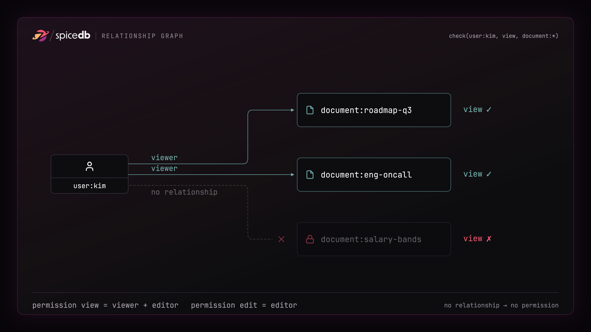

# Build Fine-Grained RAG Permissions with SpiceDB and Chroma, Part 1: The Authorization Model

!!! note "Source Code"

    The full, runnable source code for this two-part guide can be found
    [here](https://github.com/sohanmaheshwar/chroma-spicedb-rag).

Retrieval-Augmented Generation (RAG) pipelines are powerful tools for grounding large language models (LLMs) in private or domain-specific knowledge. Most RAG systems focus on the quality and speed of retrieval but often overlook an important aspect: information leakage.

For example: A new hire types "what is my CEO's salary?" into an internal
RAG-powered chatbot. The retriever does what it was built to do and finds the relevant chunk of information and hands it to the model. 
The most relevant chunk here happens to be the **confidential** compensation memo that the new hire did not have access to. This is a data breach.

In typical real-world RAG systems, different users have different levels of access to data so retrieval has
to respect who is asking, not just what they asked. It's no surprise that OWASP now lists
**Sensitive Information Disclosure** among its [Top 10 risks for LLM
applications](https://owasp.org/www-project-top-10-for-large-language-model-applications/), and this is a common way it happens: the vector store
doesn't know, or care, that a user was never allowed to see that document.

Some RAG pipelines will include broad access control mechanisms such as Role-based Access Control. This works ..until it doesn't. RBAC is limiting when the access requirements are hierarchal and complex, as in the case of most enterprise systems. This means creating new roles every time the state of your system changes - this falls apart very quickly.

That's where modern authorization methods such as Relationship-Based Access Control (ReBAC)  comes in. This is a two-part guide that shows how you can add fine-grained permissions to your RAG pipelines.

Part 1 (this article) builds the authorization *model*: the schema that decides who can see what. 
[Part 2](authorization-model-impl-with-spicedb.md) wires that model into a Chroma retrieval pipeline with working code.

## Who this is for, and how it fits

While this guide demonstrates how to add **document-level** access control for RAG, the same method can be applied to adding permissions to any resource - think code repos, messages, or even AI Agents. We'll use [SpiceDB](https://authzed.com/spicedb) - an open source implementation of Google Zanzibar - the internal authorization system that powers Google's applications such as Docs, Maps, YouTube and more. You can read the [Zanzibar whitepaper here](https://research.google/pubs/pub48190/)

## Why relationships?

There are four broad ways to model access:

- **ACLs**: A list of users per object. Simple and works for small,
  static sets.
- **Role-Based Access Control**: Roles like `reader`/`writer`. Great when access maps neatly onto a
  handful of roles. Breaks when the permissions are hierarchal (groups, orgs etc)
- **Attribute-Based Access Control**: Rules over attributes. Flexible, but the policy logic tends to
  sprawl, and "why can Kim see this?" gets hard to answer, at scale
- **Relationship-Based Access Control**: Relationship-based. Permissions are edges in a graph, and a check
  is a graph traversal.

ReBAC is the one built for the shape RAG permissions actually take. Membership,
ownership, inheritance, sharing: ReBAC stores them as relationships instead of flattening them into a label you have to recompute.

The primitive in ReBAC is a **relationship**, a tuple of the form:

```text
resource#relation@subject
```

Read it right to left: a *subject* (say `user:kim`) has a *relation* (say
`viewer`) on a *resource* (say `document:roadmap-q3`). If you stack a bunch of
edges, a permission check becomes a question about the graph: is there a path
from this user to this document that grants `view`?

## The model

A SpiceDB schema defines the types of objects found within your application, how those objects can relate to one another, and the permissions that can be computed off of those relations. Here's the schema for our RAG:

```zed
definition user {}

definition document {
	relation viewer: user
	relation editor: user

	permission view = viewer + editor
	permission edit = editor
}
```

A `document` has two relations a user can hold: `viewer` and `editor`. It exposes two
permissions. `edit` requires the `editor` relation. `view` is granted to
`viewer` **or** `editor`. The `+` is a union, and it encodes the obvious rule
that anyone who can edit can also read. Every document your retriever might
return becomes a `document:<id>` in this model, and a query is only ever allowed
to surface documents on which the asking user has `view`.

Those relations are just edges in a graph. Kim can `view` a document when a path
connects her to it, and can't when none does:



## Running SpiceDB locally

You can get a SpiceDB instance running locally in one command. This runs it with an
in-memory datastore and a preshared key. To run it in production you can either self-host it or use a [managed SpiceDB service](https://authzed.com/docs/authzed/guides/picking-a-product)

```bash
spicedb serve --grpc-preshared-key "somerandomkeyhere" --datastore-engine memory
```

(OR)

You can also run SpiceDB in a Docker container. The [companion repo](https://github.com/sohanmaheshwar/chroma-spicedb-rag) ships a `docker-compose.yml` that starts SpiceDB alongside Chroma, so `docker compose up -d` gets you both.

Now point the [`zed` CLI](https://github.com/authzed/zed) at it and load the
schema. Save the schema above as `schema.zed`, then:

```bash
zed context set local localhost:50051 "somerandomkeyhere" --insecure
zed schema write schema.zed
```

Grant Kim read access to a couple of documents by writing relationships:

```bash
zed relationship create document:roadmap-q3 viewer user:kim
zed relationship create document:eng-oncall viewer user:kim
```

And ask the question that matters:

```bash
zed permission check document:roadmap-q3 view user:kim --consistency-full
# true
zed permission check document:salary-bands view user:kim --consistency-full
# false
```

Essentially, Kim can `view` the
roadmap because a relationship says so. She can't `view` the salary bands
because no path in the graph grants it. In [Part 2](authorization-model-impl-with-spicedb.md)
we'll ask SpiceDB this exact question from inside a Chroma query, at retrieval
time, for every document the vector search wants to return.

## Going further: groups, folders, multi-tenancy

The per-document model is where you should start, but it isn't where you'll end.
One of the reasons ReBAC is suited for permissions at scale is that it grows without
forcing you to rewrite what you already have. A few edges you'll likely add:

```zed
definition user {}

definition group {
	relation member: user
}

definition folder {
	relation reader: user | group#member
	relation writer: user | group#member

	permission view = reader + writer
	permission edit = writer
}

definition document {
	relation parent: folder
	relation viewer: user | group#member
	relation editor: user | group#member

	permission view = viewer + editor + parent->view
	permission edit = editor + parent->edit
}
```

Here, `group#member` lets you grant a
permission to an entire team in one relationship. Add a person to the group and
they inherit every document the group can see, no per-document bookkeeping.
And `parent->view` is inheritance: a document's `view` permission now includes
whatever grants `view` on its parent folder. Share a folder with the platform
team, and every document in it is readable by every member, transitively.

Once folders belong to tenants, and tenants to an organization, you're modeling the same multi-tenant
hierarchy from a different angle. Resource-level and document-level access is thus described in one consistent graph.

## Next

[Part 2](authorization-model-impl-with-spicedb.md) indexes documents in Chroma so each vector points back to a
`document`, then enforcing `view` at query time with two complementary
strategies - pre-filtering and post-filtering. This will give you an
end-to-end RAG answer that changes the moment you revoke access.

We'll keep the walkthrough on the minimal model so the code stays legible. The full code repo can be accessed [here](LINK)
